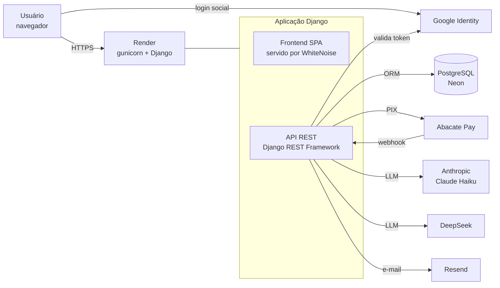
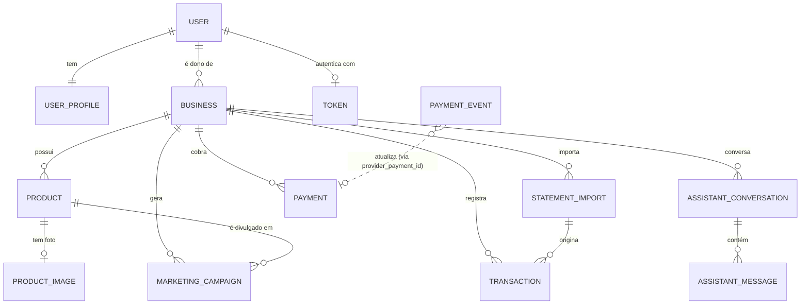
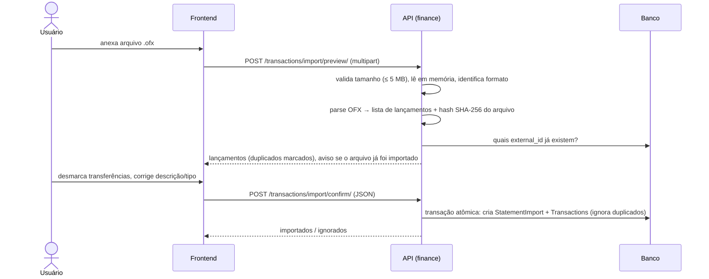

# WageUp — Documentação Técnica e Funcional para o Artigo do TCC

> Material de apoio para a escrita do artigo. Reúne, a partir do código-fonte, **o que a plataforma faz, como foi construída e por que cada decisão foi tomada**.
> Estado do projeto: 24/09/2026 (último commit na `main`). Produção: <https://wageup.onrender.com>.
>
> Documentos complementares no repositório: [`FEATURES.md`](FEATURES.md) (checklist de funcionalidades), [`CLAUDE.md`](CLAUDE.md) (arquitetura e regras), [`design-system.md`](design-system.md) (identidade visual) e [`DEPLOY-RENDER.md`](DEPLOY-RENDER.md) (implantação).

---

## Sumário

1. [Resumo do projeto](#1-resumo-do-projeto)
2. [Problema e justificativa](#2-problema-e-justificativa)
3. [Objetivos](#3-objetivos)
4. [Público-alvo e perfis de usuário](#4-público-alvo-e-perfis-de-usuário)
5. [Visão geral das funcionalidades](#5-visão-geral-das-funcionalidades)
6. [Tecnologias utilizadas](#6-tecnologias-utilizadas)
7. [Arquitetura do sistema](#7-arquitetura-do-sistema)
8. [Modelo de dados](#8-modelo-de-dados)
9. [Detalhamento dos módulos](#9-detalhamento-dos-módulos)
10. [Uso de Inteligência Artificial](#10-uso-de-inteligência-artificial)
11. [Integração de pagamentos PIX](#11-integração-de-pagamentos-pix)
12. [Segurança e privacidade](#12-segurança-e-privacidade)
13. [Interface e experiência do usuário](#13-interface-e-experiência-do-usuário)
14. [API REST — endpoints](#14-api-rest--endpoints)
15. [Testes automatizados](#15-testes-automatizados)
16. [Implantação (deploy) e operação](#16-implantação-deploy-e-operação)
17. [Processo de desenvolvimento](#17-processo-de-desenvolvimento)
18. [Decisões de projeto e seus trade-offs](#18-decisões-de-projeto-e-seus-trade-offs)
19. [Limitações conhecidas](#19-limitações-conhecidas)
20. [Trabalhos futuros](#20-trabalhos-futuros)
21. [Métricas do projeto](#21-métricas-do-projeto)
22. [Sugestão de estrutura para o artigo](#22-sugestão-de-estrutura-para-o-artigo)
23. [Glossário](#23-glossário)
24. [Referências técnicas sugeridas](#24-referências-técnicas-sugeridas)

---

## 1. Resumo do projeto

O **WageUp** é uma plataforma web para **microempreendedores brasileiros** (MEI e pequenos negócios) que reúne, num só lugar:

- **gestão financeira simplificada** — lançamento de entradas e saídas, calendário e gráfico do semestre, importação de extrato bancário (OFX);
- **cobrança via PIX** — geração de QR Code e código "copia e cola" pela Abacate Pay, com conciliação automática no financeiro quando o pagamento é confirmado;
- **catálogo de produtos com cálculo de margem real** — que considera custo, embalagem/frete, taxa de cartão/PIX e imposto, e não só "preço menos custo";
- **inteligência artificial aplicada ao negócio** — geração de campanhas de marketing, recomendações do que divulgar, insights do painel e um assistente financeiro conversacional, todos alimentados pelos números reais do usuário.

É um sistema de três camadas — interface SPA em JavaScript puro, API REST em Django/Django REST Framework e banco PostgreSQL —, implantado na nuvem (Render + Neon) com custo zero de infraestrutura.

**Resumo em uma frase (para o abstract):** plataforma web de gestão financeira, cobrança PIX e marketing assistido por IA para microempreendedores brasileiros, em que todo cálculo é feito de forma determinística no servidor e a IA apenas interpreta e redige a partir desses números.

**Palavras-chave sugeridas:** microempreendedor individual; gestão financeira; PIX; inteligência artificial generativa; modelos de linguagem; aplicação web; Django.

---

## 2. Problema e justificativa

Pontos que o próprio código e a documentação do projeto tratam como motivação (úteis para a introdução do artigo):

1. **O microempreendedor entende do próprio ofício, não de contabilidade.** O prompt do assistente descreve o público como "confeiteiras, barbeiros, quem vende marmita, quem faz unha" — gente que precisa de respostas em linguagem simples, sem jargão ("fluxo de caixa", "capital de giro", "ticket médio").
2. **A margem que o MEI enxerga costuma ser falsa.** A conta "preço − custo" ignora embalagem, frete, taxa da maquininha/PIX e imposto, que "saem do mesmo bolso". O produto parece lucrativo e na prática pode dar prejuízo. O WageUp calcula a **margem real** e mostra o prejuízo explicitamente.
3. **Ferramentas dispersas.** Cobrança (banco/maquininha), controle de caixa (planilha/caderno) e divulgação (redes sociais) vivem em lugares diferentes. A plataforma integra os três: um PIX pago vira automaticamente uma entrada no financeiro, e a margem do catálogo alimenta as sugestões de marketing.
4. **IA generativa é útil, mas erra conta.** Modelos de linguagem "erram aritmética silenciosamente, e num app financeiro um centavo errado é um bug que o usuário não percebe" (comentário em `finance/assistant.py`). O projeto propõe um padrão de uso seguro: **o servidor calcula, o modelo apenas interpreta**.
5. **O PIX é o meio de pagamento dominante entre pequenos negócios no Brasil**, o que justifica a cobrança por PIX como funcionalidade central.

---

## 3. Objetivos

### Objetivo geral
Desenvolver uma plataforma web que permita ao microempreendedor controlar suas finanças, cobrar via PIX, conhecer a margem real dos seus produtos e planejar ações de marketing com apoio de inteligência artificial.

### Objetivos específicos (todos implementados)
- Permitir cadastro e autenticação (e-mail/senha e Google), com recuperação de senha por e-mail.
- Registrar entradas e saídas e apresentá-las em painel, calendário e gráfico mensal.
- Importar extrato bancário em OFX com conferência prévia e sem duplicar lançamentos.
- Gerar cobranças PIX e conciliá-las automaticamente com o financeiro (webhook + consulta ativa).
- Manter catálogo de produtos com foto, estoque e cálculo de margem real e de preço sugerido para uma margem-alvo.
- Gerar campanhas de marketing e recomendações de divulgação com IA, baseadas na margem real.
- Gerar insights de negócio e oferecer um assistente financeiro conversacional com histórico persistente.
- Garantir isolamento de dados entre usuários e boas práticas de segurança em produção.

---

## 4. Público-alvo e perfis de usuário

**Público:** microempreendedores individuais e pequenos negócios (confeitaria, alimentação, beleza, serviços, revenda).

**Perfis (papéis) de acesso**, definidos em `accounts/models.py` (`UserProfile.role`):

| Perfil | Como é definido | O que acessa |
|---|---|---|
| **admin** | E-mail listado na variável de ambiente `WAGEUP_ADMIN_EMAILS` no momento do cadastro (ou usuário `is_staff`/`is_superuser`) | Tudo: módulo financeiro (movimentações, importação de extrato, insights, assistente) e cobranças PIX, além de produtos e marketing |
| **member** | Qualquer outro cadastro | Produtos, marketing com IA, onboarding e visão geral — **sem** o módulo financeiro |

A verificação é feita no servidor pela permissão `IsAdminRole` (`accounts/permissions.py`); o frontend apenas esconde os menus (`canAccessFinance()`), mas a segurança não depende disso.

> Contexto do TCC: por ser um protótipo acadêmico, o acesso ao financeiro/PIX é restrito a contas configuradas, pois todas as cobranças vão para uma única conta de testes da Abacate Pay (ver [Limitações](#19-limitações-conhecidas)).

---

## 5. Visão geral das funcionalidades

| Módulo | Funcionalidades principais | Perfil |
|---|---|---|
| **Página inicial (landing)** | Apresentação do produto, demonstração interativa de cobrança PIX, calculadora de margem aberta ao visitante, números animados, FAQ, páginas "como funciona" por módulo | Visitante |
| **Autenticação** | Cadastro, login, login com Google, logout, recuperação de senha por e-mail, onboarding (nome do negócio) | Todos |
| **Visão geral** | Resumo de entradas/saídas/lucro, calendário mensal com movimentações por dia, gráfico do semestre, painel de recebíveis PIX, insights com IA | Todos (dados financeiros só admin) |
| **Movimentações** | Lançamento manual, edição, exclusão, filtros por tipo e período, totais do recorte, origem de cada lançamento (manual/PIX/extrato), importação de extrato OFX, tela explicativa de integração bancária ("em breve") | Admin |
| **PIX** | Gerar cobrança (QR Code + copia e cola), acompanhar pagamento em tempo real, contagem regressiva de expiração, lista de cobranças com status, detalhes, consolidação de recebíveis | Admin |
| **Assistente de IA** | Chat em tela cheia sobre os próprios números, histórico de conversas salvo no banco, sugestões de perguntas | Admin |
| **Produtos** | Cadastro completo (nome, categoria, código/SKU, unidade, descrição), foto, preço, custo, outros custos, taxa, imposto, estoque e estoque mínimo, ativo/inativo; margem real, markup e preço sugerido calculados ao vivo | Todos |
| **Marketing com IA** | Painel "O que divulgar agora" (recomendações), gerador de campanha por produto/canal/objetivo, histórico de campanhas | Todos |
| **Ajuda** | Tela de ajuda dentro do app | Todos |
| **Administração** | Django Admin (`/admin/`) com todos os modelos, filtros e busca | Superusuário |

---

## 6. Tecnologias utilizadas

### Backend
| Tecnologia | Versão | Papel |
|---|---|---|
| Python | 3.12 | Linguagem do servidor |
| Django | 6.0.5 | Framework web (ORM, migrations, autenticação, admin) |
| Django REST Framework | 3.17.1 | API REST, autenticação por token, permissões, throttling |
| django-cors-headers | 4.9.0 | CORS |
| django-environ | 0.13.0 | Configuração por variáveis de ambiente (12-factor) |
| gunicorn | 23.0.0 | Servidor WSGI em produção |
| psycopg (binary) | 3.3.4 | Driver PostgreSQL |
| WhiteNoise | 6.11.0 | Servir o frontend e arquivos estáticos pelo próprio Django |
| requests | 2.32.5 | Chamadas HTTP (Abacate Pay, DeepSeek, Resend) |
| anthropic (SDK) | ≥ 0.40 | Acesso ao Claude Haiku |
| google-auth | ≥ 2.0 | Validação do token do login com Google |

### Frontend
| Tecnologia | Papel |
|---|---|
| HTML5 + CSS3 + **JavaScript puro (vanilla)** | SPA sem framework (≈ 3,2 mil linhas de JS, 5,1 mil de CSS, 1,8 mil de HTML) |
| GSAP 3.12 + ScrollTrigger | Animações da landing page (somente `opacity` e `transform`) |
| Google Identity Services | Botão "Entrar com Google" |
| Google Fonts | Instrument Sans (texto) e DM Mono (valores monetários); Material Symbols Rounded (ícones) |
| Canvas API | Redução da foto do produto no navegador antes do envio |

### Serviços externos
| Serviço | Uso |
|---|---|
| **Abacate Pay** (API v2) | Gateway de cobrança PIX |
| **Anthropic — Claude Haiku 4.5** (`claude-haiku-4-5-20251001`) | Campanhas de marketing, recomendações, insights do painel; alternativa no assistente |
| **DeepSeek** (`deepseek-chat`, API compatível com OpenAI) | Assistente financeiro (provedor principal) |
| **Resend** | Envio do e-mail de recuperação de senha via API HTTP |
| **Google OAuth** | Login social |
| **Render** | Hospedagem da aplicação (plano gratuito) |
| **Neon** | PostgreSQL gerenciado (plano gratuito, com backup) |
| **GitHub** | Versionamento, pull requests |

### Ambiente de desenvolvimento
SQLite local por padrão; PostgreSQL 17 opcional via `docker-compose.yml`, para espelhar produção.

---

## 7. Arquitetura do sistema

### 7.1 Visão em camadas



**Características principais:**
- **Monólito modular**: um único serviço Django serve o frontend (em `/`) e a API (em `/api/`). Isso simplifica o deploy (um serviço só) e elimina problemas de CORS em produção.
- **Cliente-servidor desacoplado por API REST**: o frontend conversa com o backend exclusivamente por JSON, com autenticação por **token** no cabeçalho `Authorization: Token <chave>`.
- **Configuração por ambiente** (princípio *12-factor app*): nenhuma chave no código; tudo em variáveis de ambiente.
- **Degradação graciosa**: toda integração externa tem um caminho alternativo (ver [seção 10.6](#106-degradação-graciosa-fallbacks)).

### 7.2 Organização do backend (apps Django)

```
backend/
├── config/           # settings, urls, health check, entrega do index.html
└── apps/
    ├── accounts/     # Autenticação, UserProfile (papel), recuperação de senha, throttles, e-mail
    ├── businesses/   # Business — o "negócio" de cada usuário (unidade de isolamento)
    ├── products/     # Catálogo, cálculo de margem, foto do produto
    ├── finance/      # Transações, importação de extrato, insights, assistente financeiro
    │   └── statements/   # Leitores de extrato, um módulo por formato (hoje: OFX)
    ├── payments/     # Cobranças PIX, cliente Abacate Pay, webhook
    └── marketing/    # Campanhas e recomendações com IA
```

Cada app segue a estrutura padrão do Django: `models.py` (dados), `serializers.py` (validação/serialização), `views.py` (endpoints), `urls.py`, `admin.py`, `tests.py` e `migrations/`.

### 7.3 Isolamento de dados (multi-inquilino simples)

- No cadastro, cada usuário ganha automaticamente um **`Business`** (`accounts/serializers.py`).
- Todo modelo de negócio (produto, transação, cobrança, campanha, conversa) tem chave estrangeira para `Business`.
- Todo *endpoint* filtra por `business__owner = usuário logado` em `get_queryset()`. Um usuário **nunca** vê dados de outro, e tentar acessar o id de um registro alheio devolve 404.
- Onde o cliente informa um id (ex.: produto usado na campanha), o servidor busca esse id **dentro do negócio do usuário** — impedindo que alguém gere campanha com o produto de outra conta.

### 7.4 Fluxo de uma requisição autenticada

1. O frontend guarda o token no `localStorage` após login.
2. `apiRequest()` (em `app.js`) envia `Authorization: Token ...` em cada chamada.
3. O DRF autentica (`TokenAuthentication`), aplica a permissão (`IsAuthenticated` por padrão, `IsAdminRole` no financeiro) e o limite de requisições.
4. A view filtra os dados pelo `Business` do usuário e responde JSON.

---

## 8. Modelo de dados

### 8.1 Diagrama entidade-relacionamento



### 8.2 Entidades

| Entidade | App | Campos relevantes | Observações |
|---|---|---|---|
| `User` | Django | username (= e-mail), email, password (hash), first_name | Modelo nativo do Django |
| `UserProfile` | accounts | role (`admin`/`member`), business_name, onboarding_completed | Propriedades `can_access_finance`, `can_manage_payments` |
| `Business` | businesses | owner, name, document | Unidade de isolamento dos dados |
| `Product` | products | name, sku, category, description, unit, price, cost, other_costs, fee_percent, tax_percent, stock, min_stock, is_active | Id UUID. Propriedades calculadas: `variable_cost`, `fee_amount`, `margin_value`, `margin_percent`, `markup_percent`, `is_low_stock`; método `price_for_margin()` |
| `ProductImage` | products | product (1:1), content_type, data (binário), checksum (SHA-256) | Foto guardada no banco; limite 400 KB; JPEG/PNG/WebP |
| `Transaction` | finance | description, type (`income`/`expense`), amount, source (`manual`/`pix`/`import`), occurred_at, external_id, statement_import | Restrição de unicidade `(business, external_id)` quando `external_id` não é vazio |
| `StatementImport` | finance | filename, file_format (ofx/csv/pdf), file_hash, imported_count, skipped_count | Guarda **só metadados**; o arquivo nunca é salvo |
| `AssistantConversation` | finance | business, title, created_at, updated_at | Título nasce da primeira pergunta |
| `AssistantMessage` | finance | conversation, role (`user`/`assistant`), content | Histórico persistente do chat |
| `Payment` | payments | provider, provider_payment_id, amount, status (`pending`/`paid`/`failed`/`refunded`/`canceled`/`expired`), metadata (JSON) | `metadata` guarda QR Code, copia e cola, cliente, expiração e ids das transações conciliadas |
| `PaymentEvent` | payments | event_id (único), event_type, raw_payload, processed_at | Garante idempotência do webhook |
| `MarketingCampaign` | marketing | product, prompt, channel, goal, status, generated_text, image_url, provider | `provider` registra se veio da IA (`anthropic`) ou do texto local (`local-demo`) |

Identificadores UUID são usados nas entidades expostas pela API (produtos, transações, cobranças, campanhas, conversas), o que evita enumeração sequencial de registros.

Valores monetários usam `DecimalField` (precisão exata, 2 casas), nunca ponto flutuante, nos cálculos de margem.

### 8.3 Migrações
12 migrações ao todo, refletindo a evolução incremental do esquema (ex.: `finance/0004_transaction_source`, `finance/0005_importacao_de_extrato`, `products/0002_cadastro_completo_e_foto`).

---

## 9. Detalhamento dos módulos

### 9.1 Autenticação e contas (`apps/accounts`)

- **Cadastro** (`POST /api/auth/register/`): cria `User`, `UserProfile` (papel definido pela lista `WAGEUP_ADMIN_EMAILS`) e `Business` numa única operação; devolve o token. E-mail único (comparação sem diferenciar maiúsculas); senha com mínimo de 8 caracteres.
- **Login** (`POST /api/auth/login/`): valida e-mail/senha e devolve token + perfil.
- **Login com Google** (`POST /api/auth/google/`): o frontend obtém uma credencial do Google Identity Services; o backend valida a assinatura do *ID token* com `google-auth` e o Client ID configurado; cria a conta no primeiro acesso.
- **Logout**: apaga o token no servidor (invalida a sessão de fato, não só no navegador).
- **Onboarding** (`PATCH /api/auth/onboarding/`): o usuário informa o nome do negócio no primeiro acesso.
- **Recuperação de senha:**
  - `POST /api/auth/password-reset/` envia um link por e-mail. A resposta é **idêntica** exista ou não a conta, para a rota não servir de verificador de cadastros (*user enumeration*).
  - O token é o `default_token_generator` do Django, que embute o hash da senha atual e o último login: o link **expira sozinho** (2 horas, configurável) e **deixa de valer assim que a senha muda**, sem tabela de tokens no banco.
  - `POST /api/auth/password-reset/confirm/` troca a senha, aplica os validadores de senha do Django e **apaga os tokens de acesso existentes** (quem redefine a senha pode estar expulsando um invasor).
  - O frontend remove `uid` e `token` da barra de endereços assim que os lê, para não ficarem no histórico do navegador.
  - Entrega do e-mail: backend próprio para a API HTTP do **Resend** (`email_backends.py`), SMTP genérico como alternativa, e impressão no console em desenvolvimento.

### 9.2 Catálogo de produtos (`apps/products`)

**Cálculo de margem real** — o núcleo de regra de negócio do projeto, implementado no modelo `Product` como "fonte única da verdade":

| Grandeza | Fórmula |
|---|---|
| Custo variável | `custo + outros_custos` (embalagem, frete, etiqueta) |
| Taxas em R$ | `preço × (taxa_% + imposto_%) / 100` |
| **Margem real (R$)** | `preço − custo_variável − taxas` |
| **Margem (%)** | `margem_real / preço × 100` — "quanto do preço sobra" |
| Markup (%) | `(preço − custo_variável) / custo_variável × 100` — "quanto foi acrescentado sobre o custo" |
| **Preço sugerido para margem-alvo** | `preço = custo_variável / (1 − (taxa_% + imposto_% + alvo_%) / 100)` |

Exemplo numérico (bom para o artigo): produto vendido a R$ 20,00, custo R$ 8,00, embalagem R$ 1,50, taxa de cartão 4% e imposto 6%.
- Conta ingênua: 20 − 8 = **R$ 12,00** (60%).
- Taxas: 20 × 10% = R$ 2,00. Margem real: 20 − 9,50 − 2,00 = **R$ 8,50 (42,5%)**.
- Para ter margem de 50%: 9,50 / (1 − 0,10 − 0,50) = **R$ 23,75**.

Regras e detalhes:
- Quando taxas + margem-alvo ≥ 100%, **nenhum preço fecha a conta** e o sistema diz isso, em vez de exibir um número absurdo.
- Margem negativa aparece como **"Prejuízo"**, com cor e rótulo textual (nunca só a cor — acessibilidade).
- Distinção explícita entre **margem** e **markup**, confusão comum entre microempreendedores.
- A tela replica a fórmula em JavaScript (`productMargin()`) só para responder **enquanto o usuário digita**; o valor oficial é o do servidor.
- Validação: percentuais entre 0 e 100; preço e custos não negativos.
- **Estoque mínimo** com alerta de "estoque baixo"; produto **ativo/inativo** para sair do catálogo sem perder histórico.
- **Unidades**: unidade, kg, g, litro, ml, metro, pacote, serviço.

**Foto do produto:**
- Reduzida **no navegador** (Canvas, lado maior 800 px, JPEG qualidade 0,8) antes do envio.
- Servidor aceita JPEG/PNG/WebP até 400 KB e grava no banco (`ProductImage`), com *checksum* SHA-256.
- Resposta com `ETag` e `Cache-Control: private`, permitindo `304 Not Modified`.
- Como a rota exige token e `` não envia cabeçalho, a tela busca a imagem via `fetch` e cria um *object URL*.

### 9.3 Módulo financeiro (`apps/finance`) — admin

- **Lançamentos** de entrada/saída, com data editável (permite lançamentos retroativos) e **origem** registrada (manual, PIX ou extrato).
- **Visão geral**: totais de entradas, saídas e lucro; **calendário** mensal com as movimentações de cada dia (gaveta de detalhes); **gráfico do semestre** desenhado pelo próprio código (SVG), com navegação por mês.
- **Filtros** por tipo e por intervalo de datas (seletor de período próprio), com totais do recorte.

#### Importação de extrato bancário (OFX)

Fluxo em **dois passos**, deliberadamente:



Por que dois passos: extrato traz **transferências entre contas próprias**, que não são receita nem despesa; importar direto "sujaria" os totais. O usuário confere antes.

Detalhes técnicos do leitor OFX (`finance/statements/ofx.py`):
- Suporta **OFX 1.x (SGML, tags sem fechamento)** e **OFX 2.x (XML)** com o mesmo código, via expressões regulares sobre cada bloco `<STMTTRN>`.
- Detecta a **codificação** pelo cabeçalho (`CHARSET:1252`, comum em bancos brasileiros) com tentativas de UTF-8/CP1252/Latin-1.
- Lê datas no formato `AAAAMMDD[HHMMSS][fuso]`, respeitando o fuso informado.
- `parse_decimal()` entende "1.234,56", "1,234.56", "R$ 1.234,56", "-120,00" e "(120,00)".
- Ignora lançamentos de valor zero; limpa descrições repetidas ("PIX RECEBIDO - PIX RECEBIDO").

**Deduplicação:** cada lançamento recebe um `external_id` — o **FITID** atribuído pelo banco ou, na falta dele, uma **impressão digital** (hash) do conteúdo + posição no arquivo. Dois lançamentos idênticos no mesmo dia recebem sufixos determinísticos. Uma restrição única no banco `(business, external_id)` garante que **reimportar o mesmo extrato não duplica nada**.

**Privacidade:** o arquivo é lido **apenas em memória** e descartado; ficam só os lançamentos confirmados e o hash do arquivo.

**Extensibilidade:** um dicionário `LEITORES` mapeia extensão → leitor. Adicionar CSV ou PDF exige apenas um novo módulo que devolva a mesma estrutura (`ParsedTransaction`) — padrão *Strategy*.

**Integração bancária direta (Open Finance):** existe apenas como **tela explicativa** ("Em breve"), que ilustra como funcionaria a conexão via agregador (ex.: Pluggy) — não há implementação nem parceria.

### 9.4 Cobranças PIX (`apps/payments`) — admin

Descrito em detalhe na [seção 11](#11-integração-de-pagamentos-pix). Resumo: gera cobrança pela Abacate Pay, exibe QR Code e copia e cola, acompanha o pagamento em tempo real, e quando pago cria automaticamente a entrada correspondente no financeiro. Painel de recebíveis consolida *recebido total*, *recebido no mês* e *a receber*.

### 9.5 Marketing com IA (`apps/marketing`)

- **Gerador de campanha** (`POST /api/marketing/chat/`): o usuário escolhe produto, canal (Instagram, WhatsApp, TikTok), objetivo (promoção, lançamento, relacionamento) e descreve o pedido. A IA devolve **chamada principal, ideia de imagem, legenda e CTA**.
- **Recomendações** (`GET /api/marketing/recommendations/`): painel "O que divulgar agora", com prioridade:
  1. produto em **prejuízo** → "Revise o preço" (não divulgar);
  2. produto de **margem alta nunca divulgado** → "Estreie a divulgação";
  3. produto com **estoque baixo** → "Reponha antes de divulgar";
  4. **melhor margem** do catálogo → "Priorize o que rende";
  5. nenhuma campanha ainda → "Teste um canal" (WhatsApp).
- Cada recomendação já traz produto, canal e objetivo: o botão **"Usar no formulário"** preenche o gerador, mas **quem clica em Gerar é o usuário** (a IA sugere; a pessoa decide).
- **Histórico** de campanhas por negócio e por produto.

### 9.6 Insights do painel (`finance/insights.py`) — admin

Botão "Gerar insights com IA" na Visão geral. O servidor agrega receita, despesa, lucro, recebido/pendente via PIX, produtos com estoque baixo e produto de melhor margem real; a IA devolve de 3 a 4 observações curtas em JSON (`title`, `text`). Sem IA, regras locais produzem insights equivalentes (saúde financeira, recebíveis, estoque, melhor margem).

### 9.7 Assistente financeiro (`finance/assistant.py`) — admin

Chat em tela cheia no qual o usuário pergunta sobre os próprios números ("quanto entrou este mês?", "qual produto rende mais?"). Detalhado na [seção 10.4](#104-assistente-financeiro).

---

## 10. Uso de Inteligência Artificial

Esta é provavelmente a seção de maior contribuição para o artigo.

### 10.1 Onde a IA é usada

| Funcionalidade | Provedor/modelo | Entrada | Saída |
|---|---|---|---|
| Campanha de marketing | Claude Haiku 4.5 | dados do produto (do banco), canal, objetivo, pedido | texto estruturado (headline, imagem, legenda, CTA) |
| Recomendações de marketing | Claude Haiku 4.5 | catálogo ordenado por margem real, sinais (nunca divulgado, estoque baixo, prejuízo) | JSON com 3–4 ações |
| Insights do painel | Claude Haiku 4.5 | métricas agregadas do negócio | JSON com 3–4 insights |
| Assistente financeiro | DeepSeek (`deepseek-chat`), Claude Haiku como alternativa | contexto financeiro calculado + histórico da conversa | resposta em texto corrido |

### 10.2 Princípio central: "o servidor calcula, o modelo interpreta"

Todos os números enviados ao modelo são **calculados previamente em Python** (somas, séries mensais, margens, totais por status). O prompt proíbe expressamente o modelo de refazer contas ou inventar valores:

> "Use APENAS os números do contexto. Nunca invente valores. Os números já vêm calculados. Não refaça contas nem some transações. Se o dado não estiver no contexto, diga com franqueza que ainda não tem essa informação."

Isso mitiga **alucinação numérica**, um risco crítico em aplicações financeiras. A IA fica responsável pelo que faz bem (linguagem, síntese, sugestão), e o código pelo que precisa ser exato (aritmética).

### 10.3 Dados vindos do banco, não do cliente

Nas rotas de marketing, o navegador envia **apenas o id do produto**; preço, custo e margem são lidos do banco (`_dados_do_produto`). Duas razões: (1) a margem do modelo desconta taxas e custos extras; (2) o cliente não pode ditar os números que chegam à IA (integridade).

Nas recomendações, o `product_id` **nunca vem do modelo**: a resposta da IA cita o produto pelo nome, e o servidor resolve esse nome contra o catálogo enviado no prompt. Uma alucinação vira, no máximo, uma recomendação sem produto vinculado — **nunca um id de outra conta**.

### 10.4 Assistente financeiro

**Contexto montado a cada pergunta** (`build_context` / `format_context`):
- totais acumulados (entradas, saídas, lucro, recebido via PIX, a receber);
- série dos **últimos 6 meses** (entradas, saídas, lucro por mês);
- cobranças PIX por status e as 10 mais recentes (só com o **nome** do cliente — CPF, e-mail e celular **não** são enviados ao provedor de IA: minimização de dados);
- até 5 produtos com preço, custo, margem e estoque;
- as 15 movimentações mais recentes.

Um aviso explícito no contexto evita dupla contagem: "uma cobrança paga vira automaticamente uma entrada no financeiro [...] Nunca some os dois."

**Engenharia de prompt (persona e tom)** — trechos do *system prompt*:
- "Fale como um amigo que entende de dinheiro, não como um banco."
- "Zero jargão. Nunca diga fluxo de caixa, capital de giro, margem operacional ou ticket médio."
- "Comece pela resposta. [...] Três ou quatro frases bastam."
- "Termine sugerindo um próximo passo concreto."
- "Você lê números e aponta caminhos. Não é contador: para imposto, nota fiscal ou declaração, oriente a procurar um profissional." (limite de responsabilidade)

**Histórico persistente e confiável:**
- Conversas e mensagens ficam no banco (`AssistantConversation`/`AssistantMessage`), sobrevivem ao recarregar a página e podem ser listadas, reabertas e apagadas.
- O **servidor é dono do histórico**: o cliente envia só a nova pergunta. Isso impede que o navegador **forje falas anteriores** do assistente (uma forma de *prompt injection*).
- Limites: 12 mensagens de histórico enviadas ao modelo, 2.000 caracteres por mensagem, 700 tokens de resposta, temperatura 0,3 (respostas mais estáveis).
- A pergunta só é gravada **depois** de haver resposta, para a conversa não ficar inconsistente.

**Cascata de provedores:** DeepSeek → Anthropic → resposta local honesta ("o assistente ainda não está configurado"), sem fingir ser IA.

### 10.5 Saídas estruturadas e validação

Recomendações e insights pedem ao modelo **somente um array JSON**. O servidor:
1. extrai o array por expressão regular (tolerante a texto em volta);
2. valida cada item (campos obrigatórios, canal e objetivo dentro das listas permitidas — senão, usa um padrão);
3. se nada for aproveitável, cai nas regras locais.

### 10.6 Degradação graciosa (fallbacks)

| Situação | Comportamento |
|---|---|
| Sem `ANTHROPIC_API_KEY` | Campanhas com texto-modelo local; insights e recomendações por regras determinísticas |
| Chave inválida / provedor fora do ar | Erro registrado em log; o usuário recebe o resultado local, nunca um erro 500 |
| JSON malformado da IA | Regras locais |
| Sem `DEEPSEEK_API_KEY` | Assistente usa Claude; sem nenhuma chave, resposta local explicativa |
| Chave recusada (401/403) | Mensagem clara em português, sem expor a mensagem do provedor |

O campo `provider` (`anthropic`, `deepseek`, `local-demo`) é devolvido e gravado, dando **transparência** sobre a origem de cada texto.

### 10.7 Controle de custo

Cada chamada a um modelo custa dinheiro. Todas as rotas de IA têm limite próprio de **60 requisições por hora por usuário** (`AIRateThrottle`), e o catálogo enviado no prompt é limitado a 12 produtos.

---

## 11. Integração de pagamentos PIX

### 11.1 Fluxo completo

```mermaid
sequenceDiagram
    actor V as Vendedor
    participant F as Frontend
    participant API as WageUp API
    participant AP as Abacate Pay
    actor C as Cliente pagador
    V->>F: preenche valor, descrição, (cliente)
    F->>API: POST /api/payments/
    API->>API: cria Payment (pending)
    API->>AP: POST /v2/transparents/create (PIX, valor em centavos, expira em 1h)
    AP-->>API: id, brCode (copia e cola), brCodeBase64 (QR), expiresAt
    API-->>F: cobrança com QR Code
    F->>V: exibe QR + contagem regressiva
    C->>AP: paga o PIX
    par Webhook (caminho rápido)
        AP->>API: POST /webhooks/abacatepay/?webhookSecret=...
        API->>API: valida segredo, deduplica por event_id
    and Consulta ativa (caminho confiável)
        loop a cada 3 s
            F->>API: POST /api/payments/<id>/check/
            API->>AP: GET /v2/transparents/check
        end
    end
    API->>API: status → paid; cria Transaction (entrada, origem PIX)
    API-->>F: status pago
    F->>V: confirmação ✓
```

### 11.2 Pontos de destaque

- **Dois caminhos de confirmação**: o *webhook* (rápido, mas depende de configuração e não alcança o ambiente local) e a **consulta ativa** feita pela tela a cada 3 segundos (confiável). Ambos convergem na mesma função `sync_payment_status`/`apply_payment_event`.
- **Conciliação automática com o financeiro**: pagamento confirmado → cria uma entrada "PIX recebido: …" com origem `pix`. Estorno → cria a saída "Estorno PIX: …".
- **Idempotência**:
  - `PaymentEvent.event_id` é único: webhook reenviado não é processado duas vezes;
  - o id da transação criada fica em `payment.metadata`, então a conciliação nunca duplica o lançamento;
  - uma cobrança **paga não volta** a pendente/expirada; só o estorno altera uma cobrança paga (máquina de estados).
- **Mapeamento de status** do provedor (`PENDING`, `PAID`, `EXPIRED`, `CANCELLED`, `REFUNDED`) para o modelo interno.
- **Dados do cliente**: a Abacate Pay exige CPF/CNPJ **e** celular juntos; se faltar um, a cobrança é gerada sem cliente (evitando erro 422).
- **Tratamento de falhas**: *timeout* de 20 s; erros de rede e respostas inválidas viram `AbacatePayError` e resposta **502** com mensagem útil; a cobrança é marcada como `failed` com o motivo. A chave é validada antes do uso (caracteres não-ASCII, como um travessão colado no lugar do hífen, geram mensagem clara).
- **Consolidação de recebíveis** (`GET /api/payments/summary/`): recebido total, recebido no mês, a receber, contagens.

---

## 12. Segurança e privacidade

| Tema | Medida implementada |
|---|---|
| **Permissão fechada por padrão** | `DEFAULT_PERMISSION_CLASSES = IsAuthenticated`. Uma rota que esqueça de declarar permissão fica inacessível, não pública. Só registro, login, Google, recuperação de senha, webhook e health check declaram `AllowAny` |
| **Controle de acesso por papel** | `IsAdminRole` no financeiro e no PIX, verificado no servidor |
| **Isolamento entre usuários** | Todo `get_queryset()` filtra pelo `Business` do usuário |
| **Limite de requisições (throttling)** | Visitante 30/min; usuário 120/min; rotas de IA 60/hora; login/registro/recuperação 10/min (contra força bruta e criação de contas em massa) |
| **Senhas** | Hash do Django (PBKDF2), validadores de senha (similaridade, tamanho, senhas comuns, só números) |
| **Enumeração de usuários** | Recuperação de senha responde igual existindo ou não a conta; mensagens de erro de token idênticas para todos os casos |
| **Tokens de recuperação** | Expiram em 2 h, invalidam-se após o uso; troca de senha derruba as sessões existentes |
| **SECRET_KEY** | Em produção, o sistema **se recusa a subir** com chave ausente, de exemplo ou com menos de 50 caracteres |
| **HTTPS** | `SECURE_SSL_REDIRECT`, cookies `Secure`, **HSTS** (1 ano, configurável), `SECURE_PROXY_SSL_HEADER` para o proxy do Render |
| **Cabeçalhos** | `X-Content-Type-Options: nosniff`, `Referrer-Policy: same-origin`, `X-Frame-Options: DENY` (anti-*clickjacking*), cookies `HttpOnly` e `SameSite=Lax` |
| **Superfície da API** | API navegável do DRF só em modo de desenvolvimento |
| **Webhook** | Autenticado por segredo compartilhado comparado com `secrets.compare_digest` (tempo constante, contra *timing attack*); responde **503** se o segredo não estiver configurado em produção; deduplicação de eventos |
| **Upload** | Extrato: só em memória (`MemoryFileUploadHandler`), limite 5 MB, arquivo ilegível → 400 com explicação. Foto: tipo restrito e limite de 400 KB |
| **Minimização de dados (LGPD)** | Extrato bancário não é armazenado (só hash e lançamentos confirmados); dados pessoais do pagador (CPF, e-mail, celular) não são enviados à IA |
| **Integridade dos dados enviados à IA** | Números lidos do banco, não do cliente; histórico do chat mantido pelo servidor |
| **Segredos** | Todas as chaves em variáveis de ambiente; `.env` fora do Git |
| **Cache do frontend** | HTML sempre revalidado; CSS/JS versionados pela data de modificação (evita página nova com estilo velho) |

Os limites do *throttle* são contados por processo (cache `LocMemCache`); com vários *workers* o limite efetivo se multiplica — para limite exato seria necessário cache compartilhado (Redis).

---

## 13. Interface e experiência do usuário

### 13.1 Arquitetura do frontend
- **SPA em JavaScript puro**, sem framework nem etapa de *build*: um `index.html`, um `app.js` e um `styles.css`, servidos pelo Django.
- Navegação por **views** alternadas (`setView()`), com menus agrupados (Financeiro: Movimentações, PIX, Assistente; Produtos; Marketing; Ajuda).
- Estado de demonstração no `localStorage` quando a API não está disponível, para a interface nunca ficar vazia.
- Configuração injetada pelo servidor no HTML (`WAGEUP_API_URL`, `WAGEUP_GOOGLE_CLIENT_ID`), com URL relativa `/api` — funciona em qualquer domínio.

### 13.2 Design system (`design-system.md`)
- **Tom**: "fintech minimalista com calor humano" — séria para transmitir confiança, acessível para não intimidar o MEI ("Nubank meets Wise").
- **Paleta** baseada em verdes (`--color-brand-dark #2D4A3E`, `--color-brand-mid #4A7C65`, `--color-brand-light #7DB896`) sobre fundo linho quente (`#F8F6F1`), com cores semânticas para positivo (`#2E7D52`), negativo (`#B84040`) e alerta (`#9B6E28`).
- **Tipografia**: Instrument Sans (interface) e **DM Mono para todo valor monetário** (alinhamento de colunas).
- Tokens em *CSS custom properties*: cores, espaçamento, raios (máx. 16 px em cards de dados), sombras.
- Convenção de nomes **BEM simplificado** (`.bloco__elemento--modificador`).
- **Mobile-first**, animações apenas de `opacity` e `transform` (desempenho), sem `!important`.

### 13.3 Acessibilidade
- Cor nunca é o único indicador: prejuízo, despesa e status sempre vêm com rótulo ou ícone.
- Valores no formato brasileiro `R$ 1.234,56`.
- `aria-label` nas seções, modais fecham com Esc.
- `prefers-reduced-motion`: animações decorativas da landing são desligadas.

### 13.4 Destaques de interação
- **Landing page** com demonstração de PIX interativa (QR ilustrativo, status "aguardando" pulsando, botão que simula o pagamento) e **calculadora de margem aberta** ao visitante — mostra valor antes do cadastro.
- **Cálculo de margem ao vivo** no cadastro de produto.
- **Tela de acompanhamento do PIX** com contagem regressiva e confirmação automática.
- **Tela de conferência** do extrato, com seleção/edição linha a linha e marcação "Já importado".
- **Gavetas (drawers)** de detalhes para dias do calendário, transações e cobranças.
- Chat do assistente com sugestões de perguntas, lista de conversas agrupada por data.

---

## 14. API REST — endpoints

| Método | Rota | Descrição | Acesso |
|---|---|---|---|
| POST | `/api/auth/register/` | Cria usuário + perfil + negócio | Aberto (10/min) |
| POST | `/api/auth/login/` | Login por e-mail/senha | Aberto (10/min) |
| POST | `/api/auth/google/` | Login com Google | Aberto (10/min) |
| POST | `/api/auth/logout/` | Invalida o token | Autenticado |
| GET | `/api/auth/me/` | Perfil do usuário logado | Autenticado |
| PATCH | `/api/auth/onboarding/` | Define o nome do negócio | Autenticado |
| POST | `/api/auth/password-reset/` | Pede link de recuperação | Aberto (10/min) |
| POST | `/api/auth/password-reset/confirm/` | Troca a senha | Aberto (10/min) |
| GET/POST | `/api/products/` | Lista / cria produtos | Autenticado |
| GET/PUT/PATCH/DELETE | `/api/products/<id>/` | Detalhe / edição / remoção | Autenticado |
| GET/POST/DELETE | `/api/products/<id>/image/` | Foto do produto | Autenticado |
| GET/POST | `/api/transactions/` | Lista / cria lançamentos | Admin |
| GET/PUT/PATCH/DELETE | `/api/transactions/<id>/` | Detalhe / edição / remoção | Admin |
| POST | `/api/transactions/import/preview/` | Lê extrato (não grava) | Admin |
| POST | `/api/transactions/import/confirm/` | Grava lançamentos confirmados | Admin |
| GET | `/api/finance/insights/` | Insights com IA | Admin (60/h) |
| POST | `/api/finance/assistant/` | Pergunta ao assistente | Admin (60/h) |
| GET/POST | `/api/finance/assistant/conversations/` | Lista / cria conversa | Admin |
| GET/DELETE | `/api/finance/assistant/conversations/<uuid>/` | Mensagens / remoção | Admin |
| GET/POST | `/api/payments/` | Lista / gera cobrança PIX | Admin |
| GET | `/api/payments/summary/` | Consolidação de recebíveis | Admin |
| POST | `/api/payments/<id>/check/` | Sincroniza status com a Abacate Pay | Admin |
| POST | `/api/payments/webhooks/abacatepay/` | Webhook da Abacate Pay | Segredo compartilhado, sem throttle |
| POST | `/api/marketing/chat/` | Gera campanha | Autenticado (60/h) |
| GET | `/api/marketing/recommendations/` | Recomendações de divulgação | Autenticado (60/h) |
| GET/POST | `/api/marketing/campaigns/` | Histórico de campanhas | Autenticado |
| GET | `/api/health/` | Health check | Aberto, sem throttle |
| — | `/admin/` | Django Admin | Superusuário |

---

## 15. Testes automatizados

Testes com o *framework* de testes do Django (`manage.py test`), **68 casos**:

| App | Casos | O que cobrem |
|---|---|---|
| `products` | 16 | Cálculo de margem real, markup, preço sugerido (incluindo o caso impossível), validações, upload/limite/tipo da foto, isolamento |
| `finance` | 15 | Leitura de OFX 1.x/2.x, codificação, datas e fusos, formatos de valor, deduplicação por FITID e impressão digital, importação ponta a ponta em dois passos |
| `accounts` | 14 | Recuperação de senha (resposta uniforme, expiração, invalidação após uso, derrubada de sessões), backend do Resend |
| `marketing` | 23 | Margem real no prompt (e não preço − custo), isolamento por negócio, recomendações (prioridades, fallback, parsing do JSON da IA, resolução do produto por nome) |
| `payments` | 0 | Ainda não coberto (ver limitações) |

Chamadas a serviços externos (IA, Resend) são simuladas (*mock*), para os testes não dependerem de rede nem gerarem custo.

Além dos testes, o README recomenda `python manage.py check --deploy` antes de publicar.

---

## 16. Implantação (deploy) e operação

- **Render** (plano gratuito) roda a aplicação; **Neon** (plano gratuito) hospeda o PostgreSQL, com backups automáticos e sem expiração (diferente do Postgres gratuito do Render, apagado após 30 dias).
- Configuração declarativa em `render.yaml` (*Infrastructure as Code*):
  - *build*: `pip install` → `migrate` → `collectstatic`;
  - *start*: `gunicorn config.wsgi:application`.
- As migrações rodam no *build* porque o *pre-deploy* do Render exige plano pago. Esse ajuste veio de um incidente real: o banco ficou parado numa migração antiga e o assistente passou a responder erro 500 (`relation ... does not exist`) — documentado em `DEPLOY-RENDER.md`, bom exemplo de lição aprendida para o artigo.
- Conexões persistentes ao PostgreSQL (`CONN_MAX_AGE=60`, *health checks* de conexão).
- `GET /api/health/` para o monitoramento do Render.
- Logs estruturados (`data nível módulo mensagem`) na saída padrão.
- Domínio próprio suportado por uma variável (`CUSTOM_DOMAIN`), que atualiza `ALLOWED_HOSTS`, CORS e CSRF.
- Limitação do plano gratuito: o serviço hiberna após ~15 min sem acesso e leva ~50 s para acordar.
- A plataforma já migrou de hospedagem uma vez (Railway → Render + Neon), o que a configuração por ambiente tornou simples.

---

## 17. Processo de desenvolvimento

- **Período**: primeiro commit em 01/06/2026; último em 24/09/2026 (≈ 4 meses).
- **Versionamento**: Git + GitHub, **87 commits** e **26 merges de pull requests**, com *branches* por funcionalidade (`feature/importar-extrato`, `feature/cadastro-de-produtos`, `feature/landing-page`, `feature/marketing-margem-real` etc.).
- **Mensagens de commit** no padrão *Conventional Commits* (`feat:`, `fix:`, `docs:`, `chore:`), em português, explicando o porquê da mudança.
- **Desenvolvimento incremental**: cada funcionalidade entrou completa (backend, frontend, testes e documentação) em seu próprio PR.
- **Documentação viva**: `FEATURES.md` atualizado a cada entrega; comentários no código explicam o motivo das decisões (não o que o código faz).
- **Uso de assistente de IA no desenvolvimento** (Claude Code), orientado por um arquivo de regras do projeto (`CLAUDE.md`) com arquitetura, regras de segurança e design system — pode ser citado na metodologia, se desejado.
- **Metodologia sugerida para descrever no artigo**: desenvolvimento iterativo e incremental, com entregas por funcionalidade, validação manual em produção (roteiro de testes em `FEATURES.md`) e testes automatizados das regras críticas.

Linha do tempo resumida (a partir do histórico do Git):
1. Estrutura inicial Django + SPA, landing page, login com Google, isolamento de dados, correções no PIX.
2. Deploy em nuvem (Railway, depois Render + Neon).
3. Integração PIX com conciliação no financeiro, consolidação de recebíveis, webhook seguro.
4. Endurecimento de segurança (permissão fechada por padrão, throttling, HTTPS/HSTS, SECRET_KEY).
5. Insights com IA e assistente financeiro com histórico persistente (DeepSeek/Claude).
6. Importação de extrato OFX com conferência e deduplicação; tela ilustrativa de integração bancária.
7. Cadastro completo de produtos com foto e margem real.
8. Recuperação de senha por e-mail (Resend).
9. Nova landing page (demo PIX, calculadora, FAQ).
10. Marketing baseado em margem real e recomendações automáticas.

---

## 18. Decisões de projeto e seus trade-offs

| # | Decisão | Motivo | Custo / trade-off |
|---|---|---|---|
| 1 | Um `Business` por usuário, criado no cadastro | Simplifica isolamento e fluxo | Não suporta múltiplos negócios/colaboradores |
| 2 | Frontend servido pelo próprio Django | Um único serviço, sem CORS em produção, deploy simples | Sem SSR/otimizações de frameworks modernos |
| 3 | JavaScript puro, sem framework | Sem build, sem dependências, leve | `app.js` grande; manutenção exige disciplina |
| 4 | Token do DRF (não JWT) | Simples, revogável no servidor (logout real) | Uma consulta ao banco por requisição |
| 5 | Papel admin por variável de ambiente | Controle de quem acessa PIX de teste | Sem promoção de papel pela interface |
| 6 | Conta única da Abacate Pay | Viável para o TCC | Em produção real exigiria subcontas por vendedor |
| 7 | API fechada por padrão | Esquecer permissão não expõe dados | Toda rota pública precisa ser declarada |
| 8 | `DEBUG` falso por padrão | Quem não configura roda seguro | Desenvolvedor precisa ligar o modo dev no `.env` |
| 9 | Importação de extrato em dois passos | Evita transferências internas como receita/despesa | Um passo a mais para o usuário |
| 10 | Arquivo de extrato não armazenado | Dado sensível; minimização (LGPD) | Não é possível reprocessar o arquivo depois |
| 11 | Foto do produto no banco | Disco do Render gratuito é efêmero | Não escala para milhares de imagens |
| 12 | Rota da foto autenticada | Segurança | Precisa de `fetch` + *object URL* no front |
| 13 | Margem sempre lida do modelo | Evita a IA recomendar desconto sobre lucro inexistente | — |
| 14 | Cálculo de margem no modelo, repetido no JS só para feedback | Fonte única da verdade | Mudou no Python, precisa mudar no JS |
| 15 | Deduplicação por `external_id` único por negócio | Reimportar não duplica | Todo novo formato precisa gerar id estável |
| 16 | Servidor calcula, IA interpreta | Evita números inventados | Contexto precisa ser montado a cada pergunta |
| 17 | Fallback local em toda IA | App funciona sem chave e com provedor fora do ar | Textos locais são menos ricos |
| 18 | DeepSeek no assistente, Claude no marketing | Custo/qualidade por caso de uso | Duas integrações para manter |
| 19 | Webhook + consulta ativa no PIX | Confirmação confiável mesmo sem webhook | Mais requisições (polling a cada 3 s) |

---

## 19. Limitações conhecidas

- **Cobranças centralizadas** numa única conta de testes da Abacate Pay; não há repasse por vendedor (subcontas).
- **Um negócio por usuário**, sem múltiplos colaboradores.
- **Sem registro de vendas por produto**: não há métricas de giro nem de produto mais vendido.
- **Importação de extrato só em OFX** (CSV e PDF previstos na arquitetura, não implementados).
- **Integração bancária (Open Finance) apenas ilustrativa.**
- **Geração de imagens para campanhas não implementada** (o campo `image_url` existe; a IA apenas descreve a imagem sugerida).
- **Sem testes automatizados do módulo de pagamentos.**
- **Throttling por processo** (cache em memória); limite exato exigiria Redis.
- **Hibernação do plano gratuito** do Render (~50 s para acordar).
- **E-mail de recuperação** depende de domínio verificado no Resend para chegar a qualquer usuário.
- O contexto do **assistente financeiro** ainda ordena e informa produtos por "preço − custo" (`build_context` em `finance/assistant.py`), diferente do restante do sistema, que usa a margem real — inconsistência pontual a corrigir.

---

## 20. Trabalhos futuros

- Subcontas/*split* de pagamento para cada microempreendedor receber na própria conta.
- Integração via **Open Finance** (agregador como Pluggy) para importar lançamentos automaticamente.
- Leitores de extrato **CSV** e **PDF**.
- **Registro de vendas** ligado ao catálogo (baixa de estoque, produtos mais vendidos, ticket médio).
- **Geração de imagens** para as campanhas.
- Múltiplos negócios e colaboradores por conta, com papéis granulares.
- Emissão de nota fiscal / integração com o Portal do Empreendedor (DAS do MEI).
- Aplicativo móvel ou PWA com notificação de PIX recebido.
- Cache compartilhado (Redis) e fila assíncrona para as chamadas de IA.
- Testes de pagamentos e testes de interface (ponta a ponta).
- Avaliação com usuários reais (usabilidade — ex.: questionário SUS — e utilidade percebida dos insights).

---

## 21. Métricas do projeto

| Métrica | Valor |
|---|---|
| Período de desenvolvimento | 01/06/2026 – 24/09/2026 |
| Commits | 87 |
| Pull requests integrados | 26 |
| Apps Django | 6 |
| Modelos de dados (próprios) | 12 |
| Migrações | 12 |
| Endpoints da API | ≈ 28 |
| Testes automatizados | 68 |
| Linhas de código — backend (Python, sem migrações) | ≈ 5,0 mil (dos quais ≈ 1,0 mil de testes) |
| Linhas de código — frontend | ≈ 10,1 mil (JS 3,2 mil; CSS 5,1 mil; HTML 1,8 mil) |
| Integrações externas | 6 (Abacate Pay, Anthropic, DeepSeek, Resend, Google, Neon) |
| Custo mensal de infraestrutura | R$ 0 (planos gratuitos) + consumo das APIs de IA |

---

## 22. Sugestão de estrutura para o artigo

1. **Resumo / Abstract** — problema, proposta, tecnologias, resultado (ver seção 1).
2. **Introdução** — contexto do MEI no Brasil, dificuldade de gestão financeira, adoção do PIX, potencial e riscos da IA generativa; objetivo do trabalho.
3. **Referencial teórico** — gestão financeira em pequenos negócios (margem × markup, fluxo de caixa); sistema de pagamentos instantâneos PIX; modelos de linguagem de grande porte (LLMs), alucinação e engenharia de prompt; arquitetura de aplicações web e APIs REST; segurança em aplicações web (OWASP Top 10) e LGPD.
4. **Trabalhos relacionados** — comparar com soluções de gestão para MEI e bancos digitais (ex.: aplicativos de gestão financeira, maquininhas, contas PJ) destacando o diferencial: margem real + IA baseada nos números do próprio negócio + PIX conciliado.
5. **Metodologia** — desenvolvimento iterativo e incremental, ferramentas, versionamento, testes (seção 17).
6. **Desenvolvimento / Proposta** — requisitos (seções 3–5), arquitetura (7), modelo de dados (8), módulos (9), IA (10), PIX (11), segurança (12), interface (13).
7. **Resultados** — sistema em produção, telas, testes (15), exemplo de margem real (9.2), exemplo de resposta do assistente, métricas (21).
8. **Discussão** — decisões e trade-offs (18), princípio "servidor calcula, IA interpreta", limitações (19).
9. **Considerações finais e trabalhos futuros** (20).
10. **Referências.**

Figuras sugeridas: diagrama de arquitetura (7.1), diagrama ER (8.1), sequência do PIX (11.1), sequência da importação de extrato (9.3), capturas de tela da landing, da visão geral, do cadastro de produto com margem, da tela de PIX, do painel de recomendações e do assistente.

> Os diagramas deste documento estão em **Mermaid** e podem ser renderizados no GitHub, no VS Code ou em <https://mermaid.live> e exportados como imagem.

---

## 23. Glossário

| Termo | Significado |
|---|---|
| **MEI** | Microempreendedor Individual |
| **PIX** | Sistema de pagamentos instantâneos do Banco Central do Brasil |
| **BR Code / copia e cola** | Código textual que representa a cobrança PIX (também exibido como QR Code) |
| **Webhook** | Chamada HTTP que um serviço externo faz ao sistema para avisar de um evento (ex.: pagamento confirmado) |
| **Idempotência** | Propriedade de uma operação que, repetida, produz o mesmo resultado (não duplica lançamentos) |
| **Conciliação** | Casar o pagamento recebido com o lançamento no financeiro |
| **OFX** | *Open Financial Exchange*, formato de extrato bancário exportado pelos bancos |
| **FITID** | Identificador único de cada lançamento dentro de um arquivo OFX |
| **Margem** | Quanto do preço de venda sobra após todos os custos e taxas (% sobre o preço) |
| **Markup** | Quanto foi acrescentado sobre o custo (% sobre o custo) |
| **LLM** | *Large Language Model*, modelo de linguagem de grande porte (ex.: Claude, DeepSeek) |
| **Alucinação** | Quando um LLM produz informação falsa com aparência de verdadeira |
| **Prompt / system prompt** | Instruções enviadas ao modelo; o *system prompt* define persona e regras |
| **Fallback** | Caminho alternativo usado quando o principal falha |
| **Throttling** | Limitação do número de requisições por período |
| **SPA** | *Single Page Application*, aplicação web de página única |
| **API REST** | Interface de comunicação por HTTP com recursos e JSON |
| **ORM** | Mapeamento objeto-relacional (acesso ao banco por classes Python) |
| **HSTS** | Cabeçalho que obriga o navegador a usar HTTPS |
| **LGPD** | Lei Geral de Proteção de Dados (Lei 13.709/2018) |

---

## 24. Referências técnicas sugeridas

(Verificar formato ABNT e datas de acesso ao citar.)

- Django Software Foundation. *Django documentation*. <https://docs.djangoproject.com/>
- Encode. *Django REST framework*. <https://www.django-rest-framework.org/>
- Banco Central do Brasil. *Pix*. <https://www.bcb.gov.br/estabilidadefinanceira/pix>
- Abacate Pay. *Documentação da API*. <https://docs.abacatepay.com/>
- Anthropic. *Claude API documentation*. <https://docs.anthropic.com/>
- DeepSeek. *API documentation*. <https://api-docs.deepseek.com/>
- OWASP Foundation. *OWASP Top 10*. <https://owasp.org/www-project-top-ten/>
- BRASIL. Lei nº 13.709, de 14 de agosto de 2018 — Lei Geral de Proteção de Dados Pessoais (LGPD).
- SEBRAE — materiais sobre gestão financeira, formação de preço e perfil do MEI.
- WIGGINS, A. *The Twelve-Factor App*. <https://12factor.net/>
- Open Financial Exchange. *OFX Specification*. <https://www.financialdataexchange.org/ofx>
- Render. *Documentation*. <https://render.com/docs> · Neon. *Documentation*. <https://neon.tech/docs>
- Mermaid. *Diagramming and charting tool*. <https://mermaid.js.org/>
